# System Requirements Document (SRD)
## Quantum Meets Automated Seminar Pipeline

**Document Status:** Approved & Updated (v1.4)  
**Target Repository:** `quantum-iiit.github.io`  

---

## 1. Executive Summary & Objective

The **Quantum Meets Automated Seminar Pipeline** is an end-to-end automation and orchestration system designed to streamline the complete lifecycle of scientific talks for the Quantum Meets seminar series.

The expanded lifecycle covers three major phases:
1. **Intake & Scheduling:** Ingesting speaker submissions from Google Forms, scraping and face-cropping portrait images from the speaker's website, formatting for GitHub CDN hosting via the `gh image` CLI extension, formatting plain-text abstracts to Markdown, validating through human checkpoints, creating Google Calendar events, and publishing to either `Upcoming` or `Pipeline` sections on `content.md` with online/offline venue resolution.
2. **Post-Event Archival & Lifecycle:** Promoting talks from `Pipeline` to `Upcoming` by Sunday noon IST, moving finished talks from `Upcoming` to `past.md`, and managing reschedules or cancellations.
3. **Video Processing & YouTube Publishing:** Editing Microsoft Teams recordings (dynamic slide crop, speaker top-right anchoring, participant blurring, speech-based intro/outro cutoff), local review gating, unlisted YouTube upload, strict metadata formatting, playlist categorization, public release sign-off, RSS generation, and dual-credit logging in `contribute.md`.

---

## 2. Process Flow & Human-in-the-Loop Architecture

```mermaid
flowchart TD
    subgraph Phase1["Phase 1: Speaker Intake, Image & Scheduling"]
        A["Speaker Accepts Invite"] --> B["Speaker Fills Google Form<br/>(Title, arXiv, Abstract, About Page, Mode)"]
        B --> C["Automated Intake Engine"]
        
        C --> D["Web Scraper Extracts Photo<br/>from About Page"]
        D --> E{"Photo Found on Website?"}
        E -- "Yes" --> F["AI / OpenCV Face Crop<br/>(Isolate face, 140px target)"]
        E -- "No" --> G["Ping Maintainer to Submit Photo"] --> F
        
        F --> H_img["Upload via gh image CLI:<br/>gh image {file} --repo {owner/repo}<br/>Extracts user-attachments CDN URL"]
        
        C --> CP1{"Checkpoint 1 (Calendar Gate):<br/>Confirm Slot & Venue"}
        CP1 -- "Approved" --> I["Create Event in Google Calendar<br/>('Quantum Meets | IIIT')"]
        
        C --> J_txt["Abstract Parser & Formatter:<br/>Plain Text -> GitHub Markdown (Math, Citations)"]
        
        H_img & I & J_txt --> CP2{"Checkpoint 2 (Website Gate):<br/>Review Markdown, Venue & CDN Image"}
        
        CP2 -- "Approved" --> K{"Is Event Date within<br/>Ceil of Next Week?<br/>(<= Next Sunday)"}
        K -- "Yes" --> L["Add to ## Upcoming in content.md"]
        K -- "No" --> M["Add to ## Pipeline in content.md"]
        
        M -.->|Sunday Noon Promotion Task| L
    end

    subgraph Phase2["Phase 2: Post-Event Transition & Git Sync"]
        L --> N["Talk Concludes Successfully"]
        N --> O["Move Talk Block from<br/>content.md to past.md"]
        O --> P["Git Commit & Push Website Transition"]
    end

    subgraph Phase3["Phase 3: Video Ingestion & Intelligent Editing"]
        Q["Raw Teams Recording (.mp4)<br/>(Local / OneDrive Ingestion)"] --> R["Speech Analysis (Whisper ASR):<br/>Host Prompt Cue & 'Thank You' Cut"]
        Q --> S["Computer Vision Layout Detection:<br/>Dynamic Slides, Speaker & Participants"]
        R --> T["Audio/Video Trimming (FFmpeg)"]
        S --> U["Dynamic Cropping, Rescaling & Blurring"]
        T & U --> V["Edited Video Preview"]
    end

    subgraph Phase4["Phase 4: Two-Stage YouTube Release & Sync"]
        V --> CP3{"Checkpoint 3 (Local Review Gate):<br/>Approve Cuts & Layout?<br/>(Optional timestamp overrides)"}
        CP3 -- "Approved" --> W["Upload to YouTube as UNLISTED"]
        W --> X["Format Strict Description<br/>(<=100 char title check, pipe separator,<br/>Bold title, Abstract, arXiv, About, Host, No tags)"]
        X --> Y["Assign to Playlist (e.g. 2026)"]
        Y --> CP4{"Checkpoint 4 (YouTube Staging Gate):<br/>Verify Unlisted URL"}
        CP4 -- "Sign-off" --> Z["Switch YouTube Video to PUBLIC"]
        Z --> AA["Update past.md with YouTube URL"]
        AA --> AB["Log to contribute.md:<br/>{Reviewer} & Quantum Bot"]
        AB --> AC["Regenerate feed.xml & Git Push"]
    end

    P --> Q
```



---

## 3. Detailed Functional Requirements

### FR-1: Speaker Intake & Google Form Ingestion
* **FR-1.1 (Google Form Intake):** Ingest responses from the Google Form:
  * Talk Title
  * arXiv / Paper URL
  * Abstract (raw text)
  * About Page (Speaker homepage, Google Scholar, or institution profile URL)
  * Scheduled Date & Time Slot
  * Mode: Online-only vs. Offline/Hybrid
* **FR-1.2 (Venue Resolution):**
  * If **Online-only**: Venue recorded as `Online-only` (or `presented online`); Teams meeting link attached.
  * If **Offline / Hybrid**: Prompt maintainer to confirm on-campus venue. Default fallback: `"Meeting Room, CQST, Vindhya (3rd level), IIIT Hyderabad"`.
* **FR-1.3 (Checkpoint 1 - Calendar Gate):**
  * Present formatted calendar event (Summary, Date/Time, Venue, Description with Teams link and abstract) to maintainer for verification.
  * Upon confirmation, create the entry on Google Calendar (*Quantum Meets | IIIT*).

### FR-2: Photo Scraping, Face Crop & Automated GitHub CDN Upload
* **FR-2.1 (Automated Photo Scraping):**
  * Crawl the speaker's "About" page to detect candidate portrait images (filtering by image dimensions, OpenGraph `og:image`, `img` tags matching profile/bio patterns).
* **FR-2.2 (Face Detection & Cropping):**
  * Detect the speaker's face using computer vision (OpenCV Haar Cascade / MediaPipe Face Detection).
  * Crop with proportional margin around the head and shoulders, producing a normalized portrait for the site (target display width: 140px).
* **FR-2.3 (Fallback Mechanism):**
  * If no photo is found or face detection confidence is low: ping the maintainer with a prompt to provide an image path/URL.
  * System applies the face cropping algorithm to the submitted image.
* **FR-2.4 (Automated GitHub CDN Hosting via `gh-image`):**
  * **Zero local attachments policy:** Images must **not** be stored in an `attachments/` folder in the repository to prevent git bloat.
  * System uploads the cropped face image using the GitHub CLI extension:
    ```bash
    gh image <path/to/cropped_face.png> --repo <owner/repo>
    ```
  * Extracts the generated markdown CDN link:
    ``
  * Embeds the extracted URL into the site's standardized `` tag:
    ``
* **FR-2.5 (Abstract Markdown Formatter & Checkpoint 2 - Website Gate):**
  * Parse raw text abstract from the Google Form into GitHub-Flavored Markdown:
    * Standardize math notation (preserve KaTeX / LaTeX math `$..$` and `\(..\)`).
    * Format academic citations (e.g., `[LG17]`, `[HEC25]`).
    * Normalize paragraph breaks.
  * Present full markdown block (heading, image, abstract, metadata table) for maintainer sign-off before committing to `content.md`.

### FR-3: Section Routing (`Upcoming` vs. `Pipeline`) & Promotion
* **FR-3.1 (Section Routing Rule - Ceil of Next Week):**
  * Calculate the target event date relative to the current week:
    * **Within the Ceil of the Next Week:** If the event occurs between the current date and the end of the next calendar week (Sunday 23:59:59 IST), insert directly under `## Upcoming` in `content.md`.
    * **Beyond the Ceil of the Next Week:** If the event is scheduled beyond next week, insert under `## Pipeline` in `content.md`.
* **FR-3.2 (Sunday Noon Promotion Schedule):**
  * **Crucial Timing:** Pipeline-to-Upcoming promotion must run by **Sunday 12:00 PM (Noon) IST**.
  * **Rationale:** By Sunday End-of-Day (EOD), the Google Apps Script email automation scrapes `content.md` and sends weekly announcement emails to the `quantum-seminars` and `quantum-meets` mailing lists.
  * As a talk enters the upcoming week's horizon, automatically migrate its markdown block from `## Pipeline` up to `## Upcoming`.
  * Maintain formatting integrity: preserve line breaks before `## Pipeline` and email boundary markers (`<!-- SKIP_START -->` / `<!-- SKIP_END -->`).

### FR-4: Event Lifecycle States (Reschedules & Cancellations)
* **FR-4.1 (Rescheduled State):**
  * Update date/time and venue.
  * Adjust section placement (`Upcoming` vs `Pipeline`) based on the new date.
  * Add note `(rescheduled to [New Date])` or `(being rescheduled)`.
* **FR-4.2 (Cancelled - Dead State):**
  * Format heading: `### ~~[{EventType}] {Speaker}—[{Title}]({Link})~~ [CANCELLED]`.
  * Remains on `content.md` until the scheduled date elapses.
  * Automatically moves to `past.md` after the date passes.
  * **Strict Exclusion:** Never enters the video editing or YouTube publishing pipeline.

### FR-5: Video Ingestion & Intelligent Editing
* **FR-5.1 (Teams UI Spatial Processing):**
  * Dynamic bounding box tracking:
    1. Slides area ($B_{slides}$)
    2. Speaker camera ($B_{speaker}$)
    3. Participant gallery ($B_{participants}$)
  * Canvas composition:
    * Expand $B_{slides}$ to fill the left canvas completely.
    * Anchor $B_{speaker}$ at the top-right column.
    * Heavily blur the remaining participant column below the speaker for privacy.
* **FR-5.2 (Temporal Audio Trimming):**
  * **Intro Cut:** Whisper ASR spots host handoff prompt (*"you can introduce yourself and begin"*, *"welcome"*, etc.) + speaker onset.
  * **Outro Cut:** Whisper ASR spots speaker saying *"Thank you"* / closing remarks.
  * **Hard Cut:** Immediately end video; exclude all post-talk Q&A and audience interaction.
* **FR-5.3 (Checkpoint 3 - Local Review Gate):**
  * Render lightweight preview.
  * Ping reviewer; support `--set-start MM:SS`, `--set-end MM:SS`, and layout tuning.
  * Video is uploaded to YouTube **only after human approval**.

### FR-6: YouTube Publication, Metadata & Post-Publish Sync
* **FR-6.1 (Strict YouTube Metadata):**
  * **Title:** `[{EventType}] {Speaker Name} | {Talk Title}`
  * **$\le 100$ Char Title Check:** If length $>100$, propose 2-3 shortened candidates + prompt for custom title input.
  * **Description Template (Exact Standard):**
    ```markdown
    **{Talk Title}**

    *Abstract.* {Abstract Text}

    *arXiv.*: {Paper / Preprint Link}

    *About.*: {Speaker Homepage or Google Scholar Link}

    *Host.* IIIT Hyderabad
    ```
  * **Tags:** Strictly **NO TAGS** (empty tag list).
* **FR-6.2 (Staging & Checkpoint 4 - YouTube Staging Gate):**
  * Upload as **`unlisted`**.
  * Add to playlist (e.g. `Quantum Seminars 2026`).
  * Reviewer verifies unlisted video link on YouTube.
  * On sign-off, switch status to **`public`**.
* **FR-6.3 (Repository Reconciliation & RSS):**
  * In `past.md`, replace placeholder `[Teams](...)` link with `[YouTube](https://youtu.be/{videoId})`.
  * In `contribute.md`, log entry: `| {Speaker Name} | {Reviewer Name} & Quantum Bot | {Event Date} |`.
  * Rebuild `feed.xml` RSS feed.
  * Commit and push all updates to `main`.

---

## 4. Human-in-the-Loop Checkpoints Summary

| Checkpoint | Trigger Point | Actions Available to Maintainer |
| :--- | :--- | :--- |
| **Checkpoint 1: Calendar Gate** | Post Google Form submission | Inspect event details & time slot; confirm venue (online vs campus default); approve Google Calendar entry. |
| **Checkpoint 2: Website Gate** | Photo scraped & face cropped, abstract converted | Inspect cropped face; verify `gh image` CDN URL; review converted Markdown abstract and Upcoming vs. Pipeline placement; approve commit to `content.md`. |
| **Checkpoint 3: Local Video Gate** | Video render complete | Review video preview; adjust `--start-time` or `--end-time`; approve for YouTube upload. |
| **Checkpoint 4: YouTube Staging Gate** | Unlisted upload complete | Review unlisted YouTube video and description; sign off to make public and sync website. |

---

## 5. Non-Functional Requirements (NFR)

* **NFR-1 (Privacy):** 100% masking/blurring of non-speaker attendees in Teams recordings.
* **NFR-2 (Clean Assets):** No repository bloat; zero image files committed to `attachments/` folder. All images hosted through `gh image` CDN (`user-attachments`).
* **NFR-3 (Execution Independence):** CLI runs locally with optional containerization; credentials kept in `.env`.
* **NFR-4 (Idempotence & Safety):** Each checkpoint saves state to `.quantum_cache/`, allowing the pipeline to pause, resume, or rerun without duplicate calendar entries or git conflicts.
