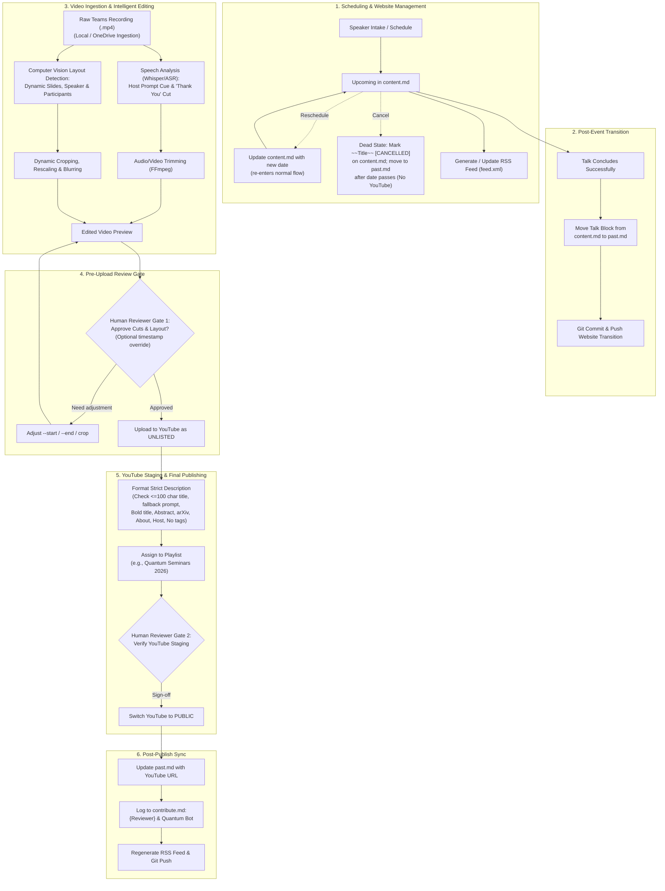

# System Requirements Document (SRD)
## Quantum Meets Automated Seminar Pipeline

**Document Status:** Approved & Finalized (v1.2)  
**Target Repository:** `quantum-iiit.github.io`  

---

## 1. Executive Summary & Objective

The **Quantum Meets Automated Seminar Pipeline** is an end-to-end automation and orchestration system designed to streamline organizing, editing, and publishing scientific talks for the Quantum Meets seminar series.

Currently, human maintainers manually perform multiple operational tasks:
1. Moving talk entries between `content.md` (Upcoming) and `past.md` (Past), and updating records during reschedules/cancellations.
2. Downloading Microsoft Teams recordings.
3. Editing recordings (cropping slides to fill canvas, positioning speaker camera in the top-right corner, blurring remaining participants, trimming intros after the host handoff, cutting after the speaker says "thank you", and excluding Q&A).
4. Reviewing the cut locally to prevent messy re-uploads.
5. Uploading finalized videos to YouTube as `unlisted`, applying strict metadata formatting (exact markdown layout, pipe separator, >100-char shortening prompt, no tags), assigning playlists, and flipping to `public` upon sign-off.
6. Updating `past.md` with the published YouTube link, generating an RSS feed, and logging contributions in `contribute.md` (crediting reviewer + bot).

**Objective:** Build a robust, modular, and automated pipeline that executes these lifecycle tasks with high fidelity, preserving recording quality, speaker focus, attendee privacy, and precise human review gates.

---

## 2. Process Flow & Human-in-the-Loop Architecture



---

## 3. Stakeholders & User Roles

| Role | Responsibility in the Automated System |
| :--- | :--- |
| **Coordinator / Host** | Invites speakers, introduces speaker during Teams session, ensures recording is saved. |
| **Automation Pipeline ("Quantum Bot")** | Detects cuts, performs layout transformations, formats metadata, automates Git, RSS, and YouTube API. |
| **Reviewer / Maintainer** | **Gate 1:** Reviews edited video preview locally (can supply timestamp overrides before upload).<br/>**Gate 2:** Verifies unlisted YouTube upload and signs off to flip to `public`. Also provides manual title override if >100 characters. |
| **Audience / Public** | Discovers talks via website, calendar, and RSS feed; views high-quality recordings on YouTube. |

---

## 4. Functional Requirements

### FR-1: Website Lifecycle & Schedule Management (`content.md` & `past.md`)
* **FR-1.1 (Multi-Event Parsing):** Dynamically parse event blocks in `content.md`, handling all event types:
  * `[Quantum Seminar]`
  * `[Quantum Talk]`
  * `[Quantum Colloquium]`
  * `[Quantum Tea]` / `[Quantum Visitor/Seminar]`
  * Extract: Event Type, Speaker Name, Affiliation, Talk Title, Paper/Preprint URL, Speaker Image URL, Abstract, Venue, Date, Time, Links.
* **FR-1.2 (Post-Event Archival):** Move completed talk blocks from `content.md` (`## Upcoming`) into the active seasonal block of `past.md` (e.g. `<details open><summary> ### May – August, 2026 </summary>`), preserving all layout elements and markdown separators.
* **FR-1.3 (Event Lifecycle States):**
  * **Rescheduled State:** Update `content.md` with the new date/time and note `(rescheduled to [New Date])` or `(being rescheduled)`. Once the new date arrives, the event proceeds through the standard lifecycle.
  * **Cancelled (Dead State):** Update `content.md` with the heading struck through (`~~Heading~~ [CANCELLED]`). Once the scheduled date elapses, automatically archive it into `past.md`. **This state terminates immediately and never enters the video/YouTube pipeline.**
* **FR-1.4 (Git Sync):** Automatically commit and push website updates with structured commit messages.

### FR-2: Intelligent Video Trimming (Temporal Editing)
* **FR-2.1 (Host Handoff Detection / Intro Cut):**
  * Detect host prompt / introduction cues via audio transcription (e.g., *"you can introduce yourself and begin"*, *"the floor is yours"*, *"welcome everyone"*).
  * Align start timestamp with the speaker's first sentence and presentation slides appearing on screen.
* **FR-2.2 (Outro Cut - Strict "Thank You" Policy):**
  * Use speech recognition (OpenAI Whisper / Vosk) to identify the concluding phrase: *"Thank you"*, *"Thank you for your attention"*, or closing remarks by the speaker.
  * **Strict Hard Cut:** Cut video immediately after the speaker's closing utterance.
  * **Strict Exclusion:** Exclude all post-talk Q&A, audience discussions, and host wrap-up.
* **FR-2.3 (Manual Override & Pre-Upload Review):**
  * Provide CLI parameters (`--start-time MM:SS`, `--end-time MM:SS`) to override detected boundaries.
  * System alerts the maintainer/reviewer when local render is complete; upload to YouTube occurs **only after explicit human approval**.

### FR-3: Layout Detection & Dynamic Compositing (Spatial Editing)
* **FR-3.1 (Compound Teams Layout Analysis):** Decompose the Microsoft Teams recording interface into:
  1. Primary Presentation Area (slides / whiteboard / screen share).
  2. Speaker Camera Feed (spotlighted tile or top camera box in the participant panel).
  3. Participant Panel / Strip (remaining attendee tiles).
* **FR-3.2 (Dynamic Bounding Box Tracking):**
  * Because Teams UI shifts dynamically when participants join/leave or layout re-renders, track coordinates dynamically across segments rather than relying on fixed pixel constants.
* **FR-3.3 (Canvas Compositing):**
  * **Slides:** Crop slides bounding box and scale to fill the primary left portion of the 16:9 canvas cleanly without dead margins.
  * **Speaker:** Crop speaker video tile and anchor precisely in the top-right column.
  * **Privacy Blurring:** Apply strong Gaussian/box blur to the entire remainder of the participant panel below the speaker video to fully protect attendee privacy.
* **FR-3.4 (Encoding Standards):** Export at source resolution (1080p minimum, 30/60 fps) using H.264 video and AAC audio for standard YouTube encoding.

### FR-4: YouTube Publication & Metadata Standards
* **FR-4.1 (Two-Stage Upload Gate):**
  * Always upload to YouTube with privacy status set to **`unlisted`**.
  * Notify the reviewer with the unlisted YouTube URL for final validation.
  * Upon confirmation, the system switches privacy status to **`public`**.
* **FR-4.2 (Strict Metadata Formatting & Length Handling):**
  * **Title Format:** `[{EventType}] {Speaker Name} | {Talk Title}`
  * **Title Length Enforcement ($\le 100$ Characters):**
    * If `len(title) > 100`: The system automatically generates 2-3 shortened title candidates and prompts the human reviewer to either select one or enter a custom title.
  * **Description Template (Exact Standard):**
    ```markdown
    **{Talk Title}**

    *Abstract.* {Abstract Text}

    *arXiv.*: {Paper / Preprint Link}

    *About.*: {Speaker Homepage or Google Scholar Link}

    *Host.* IIIT Hyderabad
    ```
  * **Tags:** Strictly **NO TAGS** (empty tag list).
* **FR-4.3 (Playlist Categorization):**
  * Automatically resolve playlist name using category and year (e.g., `Quantum Seminars 2026`, `Quantum Talks-2026`).
  * Add the video to the target playlist via the YouTube Data API.

### FR-5: Post-Publishing Website & Contributor Reconciliation
* **FR-5.1 (`past.md` Link Update):**
  * Replace the placeholder `[Teams](...)` link in the table with the finalized `[YouTube](https://youtu.be/{videoId})` link.
* **FR-5.2 (`contribute.md` Dual Credits):**
  * Append a new entry to the Video Editing Contributions table:
    `| {Speaker Name} | {Reviewer Name} & Quantum Bot | {Event Date} |`
* **FR-5.3 (Git Commit & Push):** Commit and push updated `past.md` and `contribute.md`.

### FR-6: RSS Feed Syndication (`feed.xml`)
* **FR-6.1 (Automated Generation):** Generate and maintain an RSS 2.0 / Atom feed (`feed.xml` or `atom.xml`) in the repository root.
* **FR-6.2 (Feed Content):**
  * Upcoming events: Title, Speaker, Affiliation, Date & Time, Abstract, Paper URL, Teams link.
  * Recently published past events: Title, Speaker, Date, Abstract, YouTube recording URL.
* **FR-6.3 (Subscriber Experience):** Enable researchers and students to subscribe to Quantum Meets announcements via RSS readers (Feedly, NetNewsWire, etc.).

---

## 5. Non-Functional Requirements (NFR)

| Metric | Requirement |
| :--- | :--- |
| **NFR-1: Visual & Audio Quality** | Text on slides must remain crisp and readable; audio must remain synchronized with zero clipping. |
| **NFR-2: Privacy Guarantee** | 100% masking/blurring of non-speaker participant faces, names, and profile pictures. |
| **NFR-3: Operational Model** | **Engine-agnostic CLI**: Runs locally on the maintainer's workstation using local storage (Option A for raw recordings), with no mandatory cloud hosting bills. Packaged for optional containerized execution (Docker / Modal / Cloud Run Job). |
| **NFR-4: Security & Secrets** | YouTube OAuth credentials and GitHub personal access tokens stored securely in `.env` / environment variables; never committed to git. |
| **NFR-5: Modularity & Idempotency** | Each module (Metadata Extractor, Video Processor, YouTube Client, Site Updater, RSS Generator) can be executed standalone or orchestrated in a batch run. |

---

## 6. Project Roadmap & Deliverables

1. **Requirements Document (Approved)**: Scope, requirements, and review gates finalized.
2. **High-Level Design (HLD) (Next)**:
   * System Architecture and Component Decomposition.
   * State Machines (Event Lifecycle, Video Processing Pipeline).
   * Data Models & Schemas.
   * Reviewer CLI Interface & Notification Contracts.
3. **Low-Level Design (LLD)**:
   * Algorithm for dynamic layout detection (slides, speaker box, participant gallery).
   * Audio speech recognition & cue matching (Whisper model, confidence threshold).
   * Markdown AST parser/updater and RSS builder.
   * YouTube API integration.
4. **Implementation & Verification**:
   * Build clean, modular codebase.
   * End-to-end testing with sample inputs.

