# System Requirements Document (SRD)
## Quantum Meets Maintainer Tools

**Document Status:** Updated (v2.0, 2026-10-26). Scope reduced to two tools; supersedes v1.5.
**Target Repository:** `quantum-iiit/quantum-iiit.github.io`
**Implementation:** [`automation/apps-script/`](automation/apps-script/README.md) (one Google Apps Script web app)

---

## 1. Summary & Scope

The **Google Calendar is the ground truth** for every Quantum Meets talk:
<https://calendar.google.com/calendar/embed?src=b02429b4ded9c76a1e5e691621d9da9263d3393d55efba77086f8b688470d589%40group.calendar.google.com&ctz=Asia%2FKolkata>

When a talk is confirmed, a maintainer fills in its calendar event: title, time, abstract, arXiv, About and venue. The host is always IIIT Hyderabad. Two tools then move that information to the website and to YouTube. Both are tabs of one Google Apps Script web app.

| Tool | Input | Output |
|-|-|-|
| **Tool 1: Calendar → Website** | The maintainer runs it after updating the calendar. Optionally, a speaker photo. | A pull request adding missing talks to `content.md`. A maintainer merges it. |
| **Tool 2: YouTube metadata** | A YouTube link (unlisted recording) and the speaker's name | The title and description saved on the video after a preview. Optionally the video is made public, and a PR links it from `past.md`. |

**Out of scope.** These v1.5 items are deferred and not built:

- Google Form intake
- Scraping photos from the speaker's page, and face cropping
- Creating calendar events
- Automatic Sunday Pipeline→Upcoming promotion
- Reschedule and cancellation automation
- Moving talks to `past.md`
- Video editing (cropping, blurring, Whisper trimming)
- YouTube upload and playlists
- `contribute.md` logging
- The RSS feed

---

## 2. Process Flow

```mermaid
flowchart TD
    classDef gate fill:#fef3c7,stroke:#b45309,color:#78350f;
    classDef action fill:#eff6ff,stroke:#1d4ed8,color:#1e3a8a;
    classDef done fill:#ecfdf5,stroke:#047857,color:#064e3b;

    subgraph T1["Tool 1: Calendar → Website"]
        A["Maintainer updates the Google Calendar event"] --> B["Maintainer opens the web app"]:::action
        B --> C["Repository check: upstream main HEAD,<br/>fork behind/ahead, open tool PRs"]:::action
        C --> CP1{"Branch up to date?<br/>(Sync fork if not)"}:::gate
        B --> D["Read upcoming calendar events;<br/>compare with content.md + past.md"]:::action
        D --> E["Missing talks → generated entries<br/>(Upcoming / Pipeline by date)"]:::action
        E --> F["Maintainer adds affiliation, uploads photo<br/>→ GitHub-hosted image URL"]:::action
        F --> CP2{"Review markdown + rendered preview;<br/>confirm calendar & branch are current"}:::gate
        CP1 --> CP2
        CP2 --> G["Branch from main → commit content.md → open PR"]:::action
        G --> H["Maintainer merges the PR"]:::done
    end

    subgraph T2["Tool 2: YouTube metadata"]
        I["Talk recorded, uploaded UNLISTED<br/>without metadata"] --> J["Maintainer enters YouTube link + speaker"]:::action
        J --> K["Talk data from past.md / content.md;<br/>About (and missing arXiv) from the calendar"]:::action
        K --> L["Title + description in the channel format"]:::action
        L --> CP3{"Preview as on YouTube; edit if needed"}:::gate
        CP3 --> M["Save metadata (still unlisted)"]:::action
        M --> CP4{"Everything correct?"}:::gate
        CP4 --> N["Make public"]:::done
        CP4 --> O["Optional PR: [Teams] → [YouTube] link in past.md"]:::done
    end
```



---

## 3. Functional Requirements

### FR-1: Calendar Event Format (maintainers' input)
* **FR-1.1 (Summary):** `[{EventType}] {Speaker Name} ({mode note})`, e.g. `[Quantum Seminar] Daochen Wang (presented online)`.
* **FR-1.2 (Description):** the Teams link line, then the talk title in bold, then the abstract (one or more paragraphs; an `Abstract.` label is optional), then labelled lines:
  * `arXiv.` link (optional)
  * `About.` speaker homepage or Scholar link (optional; needed by Tool 2)
  * `Venue.` text, e.g. `Meeting Room, CQST, Vindhya (3rd level), IIIT Hyderabad`, or `Online-only`
  * `Affiliation.` and `Photo.` (optional; otherwise entered in Tool 1)
* **FR-1.3 (Raw bookings):** events whose description is still the raw Cal.com text (`What:` / `Need to reschedule or cancel?`) are reported as *not curated* and never published.

### FR-2: Tool 1, Calendar → Website
* **FR-2.1 (Trigger):** the maintainer runs it from the web app once the calendar is up to date. It is not scheduled.
* **FR-2.2 (Repository check):**
  * Show the latest commit on upstream `main`.
  * Show whether the maintainer's fork `main` is behind upstream, with a **Sync fork** action.
  * Warn about PRs from these tools that are still open, so the same talk isn't added twice.
  * Without a fork, a maintainer who can push upstream gets PR branches on upstream instead.
* **FR-2.3 (Is the event on the webpage?):** for every calendar event that has not ended, find a talk in `content.md` or `past.md` with the same speaker (or title) on the same date. Report each event as one of:
  * *On website*
  * *Missing*
  * *Date differs*: the same speaker within 60 days, a likely reschedule. This is reported only; fix it by hand.
  * *Not curated*
  * *Cancelled*
* **FR-2.4 (Entry generation):** each *Missing* event becomes a block in the existing `content.md` layout:
  * Heading: `### [{EventType}] {Speaker}—[{Title}]({arXiv}) ({mode note})`
  * Photo, abstract, clear div
  * Table: Event | Speaker | Affiliation | Venue | Date | Time | Link
    * Date is `Wednesday, November 4, 2026`.
    * Time is `11:00am – 12:30pm`, in IST.
    * Link is the Teams link.
* **FR-2.5 (Section routing):** if the talk starts before the end of next week (Sunday 23:59:59 IST), the block goes under `## Upcoming`; otherwise under `## Pipeline`. Blocks are inserted in date order. The maintainer can override the section. Markers (`<!-- Upcoming event details go below -->`, the line break before Pipeline, `<!-- SKIP_START -->`) and every other block are left untouched.
* **FR-2.6 (Affiliation):** not in the calendar, so the maintainer enters it. It is pre-filled from the speaker's previous talk, or from an `Affiliation.` line.
* **FR-2.7 (Photo → GitHub link):**
  * The maintainer picks an image in the web interface.
  * It is resized to 280 px wide (2× the 140 px display width).
  * It is committed to the **`speaker-photos`** branch: of upstream if the maintainer can push there, otherwise of their fork. It is never committed to `main`.
  * The `raw.githubusercontent.com/{repo}/speaker-photos/photos/{file}` URL goes into ``.
  * A returning speaker's previous photo is offered automatically. A URL can also be pasted.
  * *Change from v1.5:* `gh image` / `github.com/user-attachments/…` links have no public API, so Apps Script cannot create them.
* **FR-2.8 (Review, Checkpoint 1):** each entry is shown as editable markdown next to a rendered preview. The maintainer:
  * chooses which entries to include
  * confirms that the calendar is up to date and the branch is current.

  The PR button stays disabled until then, and while the fork is behind.
* **FR-2.9 (Commit & PR):**
  1. Create a branch `calendar-sync-{yyyyMMdd-HHmmss}` from upstream `main`.
  2. Commit `content.md` on it.
  3. Open a PR to `main` with a summary of the added talks.

  This is the API equivalent of `git add`, `git commit` and opening a PR. It refuses if `main` moved after the page was loaded, or if a selected talk is already on the site. The tool never pushes to `main`; a maintainer merges the PR.
* **FR-2.10 (Activity log):** every step (reads, uploads, branch, commit, PR link) is shown in the web interface.

### FR-3: Tool 2, YouTube Metadata
* **FR-3.1 (Inputs):** a YouTube link (`youtu.be/…`, `watch?v=…`, `/live/…` or a YouTube Studio link) and the speaker name. The name field suggests speakers from the website. The video is assumed to be already uploaded as **unlisted**, without metadata.
* **FR-3.2 (Speaker data):**
  * From the website metadata (`past.md`, then `content.md`, on `main`): event type, speaker, title, abstract, arXiv. If the speaker has several talks, the most recent past one is used and the maintainer can pick another.
  * From the calendar event on the talk's date: `About.`, and the arXiv link when the website has none. The tool shows which source each field came from.
* **FR-3.3 (Title):**
  * Format: `[{EventType}] {Speaker Name} | {Talk Title}`.
  * Titles must be at most 100 characters. A longer title gets up to three shorter suggestions (main title before a colon, event type without "Quantum", or a truncated title), and the maintainer can type their own.
* **FR-3.4 (Description):** use the format already used on the channel. YouTube renders `*text*` as bold.
  ```
  *{Talk Title}*

  *Abstract.* {Abstract Text}

  *arXiv.* {Paper / Preprint Link}

  *About.* {Speaker Homepage or Google Scholar Link}

  *Host.* IIIT Hyderabad
  ```
  * *Change from v1.5:* the title is in single asterisks, and the labels have no colon, to match published videos.
  * The `arXiv.` and `About.` lines are left out, with a warning, when there is no link.
  * The description must be at most 5000 bytes.
  * `<` and `>` are replaced with `＜` and `＞`, because YouTube rejects them.
  * **No tags.**
* **FR-3.5 (Preview, Checkpoint 2):** an editable title and description are shown next to a YouTube-style preview: the embedded player, title, channel, privacy badge, and the rendered description. The current metadata on YouTube is shown for comparison.
* **FR-3.6 (Save):** update only the video's title, description and tags (snippet). The privacy setting stays as it is (unlisted).
* **FR-3.7 (Publish, Checkpoint 3):** **Make public**, after a confirmation prompt. This can also be done in YouTube Studio.
* **FR-3.8 (Website link, optional):** a PR (branch `youtube-link-…`) replaces the talk's `[Teams](…)` link in `past.md` (or `content.md`) with `[YouTube](https://youtu.be/{videoId})`. It changes only that line.

---

## 4. Human-in-the-Loop Checkpoints

| Checkpoint | Where | Maintainer action |
| :--- | :--- | :--- |
| **1: Website gate** | Tool 1, before the PR | Sync the fork if it is behind. Fill in affiliation and photo. Review the markdown and preview. Confirm the calendar and branch are current. |
| **PR review** | GitHub | Review and merge the PR. |
| **2: YouTube preview** | Tool 2, before saving | Check or edit the title and description against the preview. |
| **3: Publish** | Tool 2, after saving | Make the video public. Optionally open the `past.md` link PR. |

---

## 5. Non-Functional Requirements

* **NFR-1 (Platform):** the tools are a Google Apps Script web app that executes *as the user accessing it*:
  * Calendar access is read-only (Calendar advanced service).
  * YouTube calls run as the maintainer's own Google account, which must manage the channel (YouTube Data API advanced service).
  * GitHub is reached through its REST API.
* **NFR-2 (Credentials):** each maintainer's GitHub token (classic, `public_repo` scope) is stored in their own Apps Script user properties. It is never committed and never shared between maintainers.
* **NFR-3 (Clean assets):** no image files on `main`. Photos live on the `speaker-photos` branch.
* **NFR-4 (Safety & idempotence):**
  * The tools never push to `main`; every change is a PR.
  * Running a tool again doesn't duplicate entries, because it checks against the website and against open tool PRs.
  * PRs are refused when `main` changed since the data was read.
  * Calendar data is only read.
* **NFR-5 (Formatting integrity):** generated blocks match the existing `content.md` layout byte for byte, because the weekly announcement email script scrapes it. Only insertions are made.
* **NFR-6 (Testability):** parsing and rendering are plain JavaScript and tested with Node against the real `content.md` and `past.md` (`node --test automation/apps-script/test/*.test.js`).

---

## 6. Changes from v1.5

1. Scope is reduced to two tools (Calendar → Website, YouTube metadata). Everything else is deferred (§1).
2. The Google Calendar replaces the Google Form as the source of talk details. Maintainers curate the event (FR-1).
3. The implementation is a Google Apps Script web app instead of a local CLI. `.env` and `.quantum_cache/` are no longer used.
4. Git operations are done through the GitHub API (branch → commit → PR), after an explicit check that the branch is up to date.
5. Photos are uploaded in the web interface and hosted on a `speaker-photos` branch. This replaces `gh image` and the `user-attachments` CDN, which have no API.
6. YouTube: the tool adds metadata to an already-uploaded unlisted video and does not upload it. The description format now matches the published videos (FR-3.4). Speaker data comes from the website, plus `About.` from the calendar.
